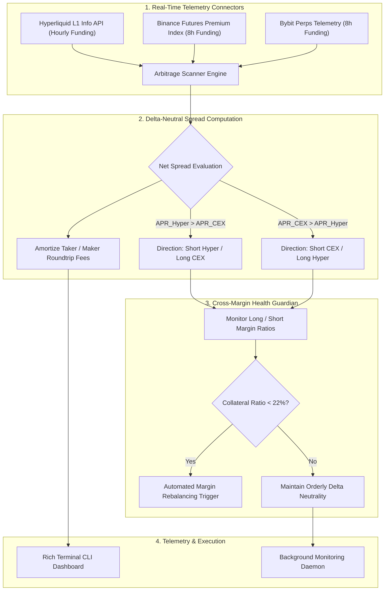

# 📈 Hyperliquid-Funding-Arbitrage: Cross-Exchange Delta-Neutral Yield Engine

[](https://python.org)
[](https://hyperliquid.xyz)
[](https://binance.com)
[](https://docker.com)
[](https://github.com)
[](https://opensource.org/licenses/MIT)

> An institutional-grade quantitative cash-and-carry and perpetual funding rate arbitrage engine. Capitalizes on real-time APR discrepancies between **Hyperliquid L1 DEX** and Centralized Exchanges (**Binance** and **Bybit**), opening delta-neutral hedged positions to harvest 15% to 60%+ market-neutral yields with automated margin liquidation guardians.

---

### 💼 Need Custom Crypto Arbitrage Bots, Basis Trading Desks, or Hedge Fund Systems?
I engineer high-performance trading software, low-latency exchange connectors, and automated delta-neutral yield farms for crypto syndicates and private wealth managers.
* 💬 **Telegram:** [@JanzebBlockdev](https://t.me/JanzebBlockdev)
* 💼 **Fiverr Profile:** [jahanzaib313110 (Fiverr Pro Specialist)](https://www.fiverr.com/jahanzaib313110)
* 🌐 **GitHub Portfolio:** [@jahanzaib-codes](https://github.com/jahanzaib-codes)

---

## 🏛️ System Architecture



---

## ✨ Key Architectural Highlights

* **Hyperliquid L1 Native Integration:** Directly polls Hyperliquid's official `metaAndAssetCtxs` endpoint to ingest real-time mark prices, hourly funding rates, and open interest for the entire perpetual universe.
* **CEX Basis Matching:** Automatically normalizes and reconciles 1-hour Hyperliquid funding rates against 8-hour Binance and Bybit funding rates to annualize true net yields.
* **Fee-Amortized Net Spread APR:** Accounts for roundtrip trading fees, taker slippage, and funding frequency differences to display strictly profitable opportunities.
* **Cross-Margin Liquidation Guardian:** Continuously calculates margin ratios on both venues to protect delta-neutral pairs from margin calls during massive directional market expansions.
* **Simulation & Live Ready:** Ships with instant CLI terminal scanner and containerized background daemon.

---

## 🚀 Quickstart Guide

### 1. Installation
```bash
git clone https://github.com/jahanzaib-codes/Hyperliquid-Funding-Arbitrage.git
cd Hyperliquid-Funding-Arbitrage

# Create virtual environment
python -m venv venv
source venv/bin/activate  # On Windows: venv\Scripts\activate

# Install dependencies
pip install -r requirements.txt
```

### 2. Run Interactive Live Terminal Scanner
Scan live cross-exchange funding rates and discover top delta-neutral spreads right now:
```bash
python cli.py scan
```

### 3. Run Background Monitoring Daemon
```bash
# Direct Python execution
python main.py

# Or via Docker Compose
docker compose up -d
```

---

## 🖥️ Terminal Dashboard Preview

```text
📡 Connecting to Hyperliquid L1 Info & CEX Funding Telemetry...

                 ⚡ Hyperliquid Perpetual Funding Universe                  
┌─────────────┬────────────┬─────────────┬────────────────┬────────────────┐
│ Perp Symbol │ Mark Price │ Hourly Rate │ Annualized APR │  Open Interest │
├─────────────┼────────────┼─────────────┼────────────────┼────────────────┤
│ BTC-PERP    │ $73,934.00 │    +0.0013% │        +10.95% │ $2,995,129,483 │
│ ETH-PERP    │  $2,064.82 │    +0.0013% │        +10.95% │ $1,603,264,282 │
│ ATOM-PERP   │      $1.41 │    -0.0024% │        -21.24% │     $4,570,031 │
│ SOL-PERP    │     $82.99 │    +0.0013% │        +10.95% │   $391,313,664 │
└─────────────┴────────────┴─────────────┴────────────────┴────────────────┘

               💰 Cross-Exchange Delta-Neutral Arbitrage Spreads               
┌───────┬─────────┬─────────┬─────────┬─────────┬─────────┬─────────┬─────────┐
│ Asset │ Long    │ Short   │ Long    │ Short   │ Net APR │ Daily   │ Direct. │
├───────┼─────────┼─────────┼─────────┼─────────┼─────────┼─────────┼─────────┤
│ ZK    │ BINANCE │ HYPERL. │ -2.66%  │ +10.95% │ +12.65% │ $3.47   │ LONG_C. │
└───────┴─────────┴─────────┴─────────┴─────────┴─────────┴─────────┴─────────┘

🎯 Top Delta-Neutral Basis Pick: Short HYPERLIQUID vs Long BINANCE on ZK yielding 12.65% Net APR completely market-neutral!
```

---

## 🛡️ License
Distributed under the **MIT License**. See [`LICENSE`](LICENSE) for complete details.
